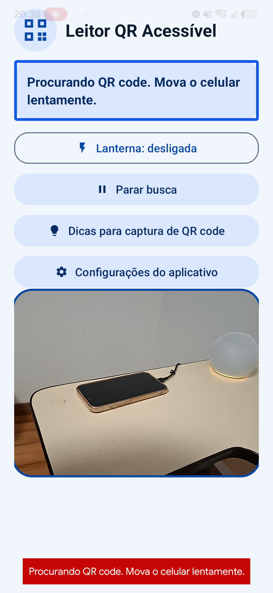
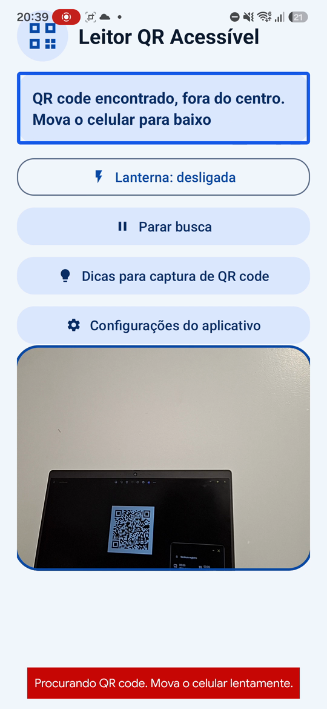
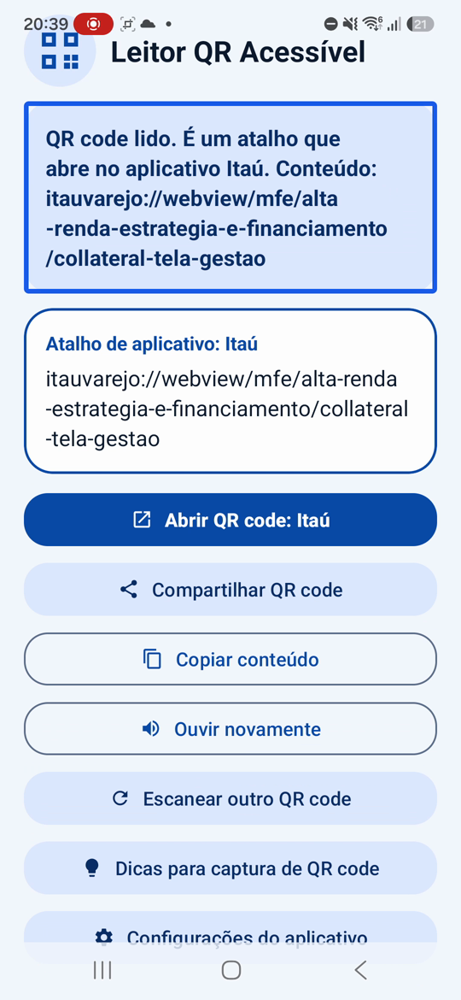

# Leitor QR Acessível (Android)

Aplicativo Android que ajuda pessoas cegas a encontrar, enquadrar e ler um QR code sozinhas. A câmera traseira guia a busca por voz (opcional), bips e vibração até o código estar bem enquadrado. Depois de ler, o app mostra o conteúdo com ações seguras: abrir o link, copiar, compartilhar e ouvir novamente.

**Versão atual para testes:** 1.4.0 · **Licença:** GPLv3 · **Plataforma:** Android 8.0 (API 26) ou superior

## Instalar a versão de teste

1. Baixe o APK na [release 1.4.0](https://github.com/Ani-s-balbino/LeitorQRAcessivel/releases/tag/v1.4.0).
2. No celular, abra o arquivo e permita a instalação de apps desconhecidos, se pedir.
3. Ou, pelo computador, com o celular conectado por USB, rode:

```
powershell -ExecutionPolicy Bypass -File .\scripts\instalar-android.ps1
```

## Principais funções

- Busca guiada com avisos de direção, distância e inclinação.
- Feedback escolhido pela pessoa: nenhum, bips, vibração, ou vibração e bips.
- Voz do aplicativo opcional, em português, para quem não usa o TalkBack.
- Leitura do QR code com ações: abrir, copiar, compartilhar e ouvir novamente.
- Parar e retomar a busca, e lanterna.
- Tela de dicas para captura (papel em modo paisagem, tela de computador, distância e luz).
- Configurações do aplicativo, política de privacidade e termos, e envio de feedback por e-mail.

## Capturas de tela





## Documentação

- [Relatório de testes 1.4.0 (Markdown)](docs/RELATORIO_DE_TESTES.md) · [versão Word](docs/RELATORIO_DE_TESTES.docx)
- [Roteiro de testes](docs/ROTEIRO_DE_TESTES.md)
- [Versionamento e histórico](docs/VERSIONAMENTO.md)

## Como compilar

O projeto traz o Gradle wrapper (`gradlew`). Você precisa do JDK 17 ou superior e do Android SDK (o Android Studio instala os dois).

```bash
./gradlew :app:testDebugUnitTest   # testes unitários
./gradlew :app:lintDebug           # análise de código
./gradlew :app:assembleDebug       # APK de depuração em app/build/outputs/apk/debug/
```

No Windows, use `gradlew.bat` no lugar de `./gradlew`.

## Privacidade

Nenhum dado pessoal é coletado ou enviado. A leitura do QR code é feita no próprio aparelho. A política completa está dentro do aplicativo, em Configurações do aplicativo > Privacidade e termos.

## Versão para iPhone

Existe uma versão em SwiftUI para iPhone: [LeitorQRAcessivel-iOS](https://github.com/Ani-s-balbino/LeitorQRAcessivel-iOS).

## Licença

Este projeto é distribuído sob a [GNU GPLv3](LICENSE). Você pode usar, estudar, modificar e redistribuir o código. Se distribuir uma versão modificada, ela também precisa ser publicada sob a GPLv3, com o código-fonte disponível.
