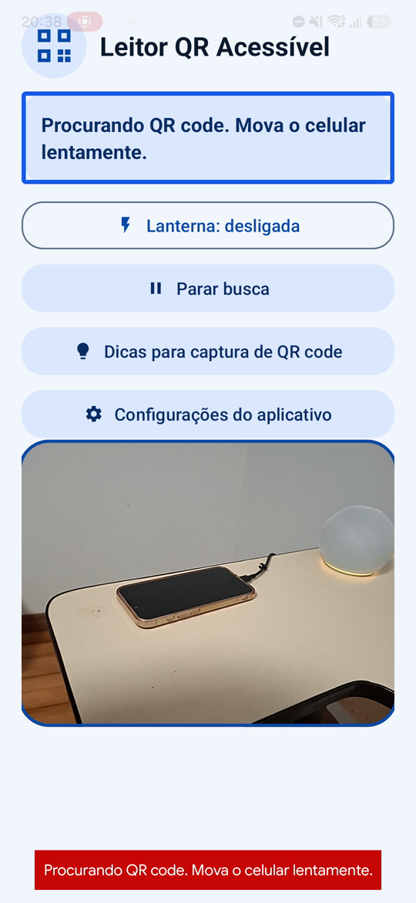
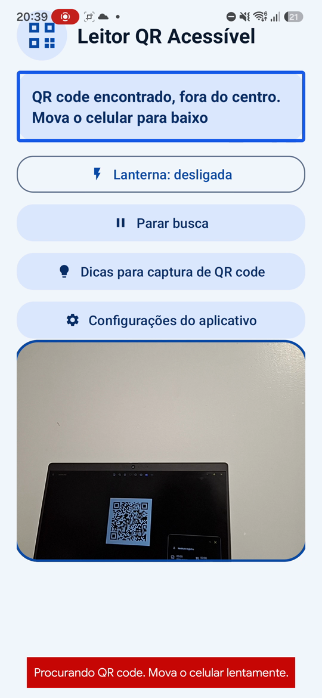
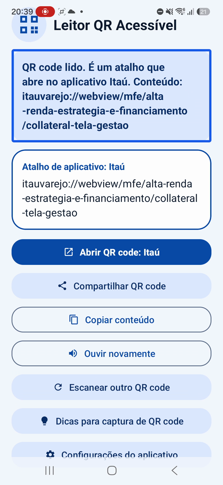
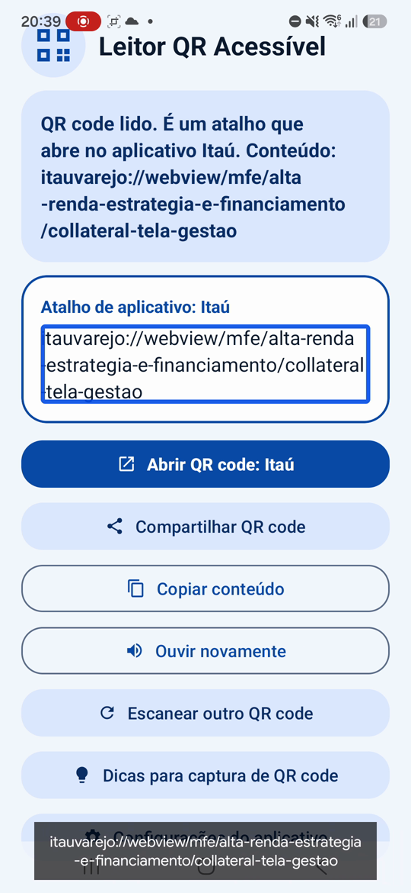
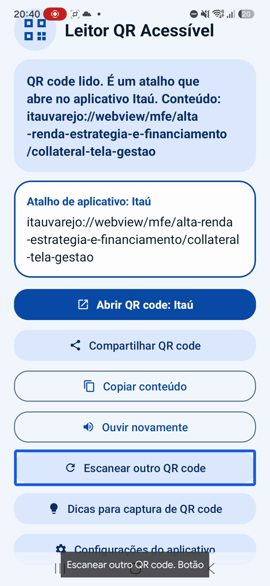

# Relatório de testes: versão 1.4.0

**Data do teste:** 25/11/2026
**Versão testada:** 1.4.0 (versionName) · versionCode 7
**Aparelho:** Samsung Galaxy A55 5G · Android: não informado
**Leitor de tela:** TalkBack
**Vídeo de referência:** `Screen_Recording_20261125_204042` (2 min)
**Repositório:** https://github.com/Ani-s-balbino/LeitorQRAcessivel

## 1. Resumo

| Área | Resultado |
|---|---|
| Testes unitários (automatizados) | 22 de 22 passaram |
| Lint (análise de código) | 0 avisos |
| Busca guiada com TalkBack | **Passou** (observado no vídeo) |
| Avisos lidos automaticamente pelo TalkBack | **Passou**, sem arrastar a tela |
| Leitura do QR code: tempo até o aviso "QR code lido" | **Ajuste pendente**: o aviso demora por causa da fila |
| Bips e vibração | **Passou**, funcionam bem |
| Opção "Nenhum" no feedback | Não observada no vídeo: a testar |
| Voz do aplicativo desligada por padrão | Confirmado: a pessoa testadora usou o TalkBack |

**Conclusão:** a versão 1.4.0 lê os avisos automaticamente com o TalkBack. Resta um ajuste: os textos que ficam na fila de leitura atrasam o aviso "QR code lido".

## 2. Evidências (prints do vídeo, no Android)

### 2.1 Busca guiada

Aviso "Procurando QR code. Mova o celular lentamente." aparece com os botões de lanterna, parar busca, dicas e configurações.

Aviso "QR code encontrado, fora do centro. Mova o celular para baixo." O TalkBack leu o aviso sem arrastar a tela.

### 2.2 Leitura e ações

Aviso "QR code lido. É um atalho que abre no aplicativo Itaú." com o conteúdo lido na tela.

Botões de ação: abrir QR code, compartilhar, copiar conteúdo, ouvir novamente e escanear outro QR code. "Conteúdo copiado" também foi exibido.

### 2.3 Dicas e configurações

Os botões "Dicas para captura de QR code" e "Configurações do aplicativo" aparecem no fim da tela de busca.

## 3. Itens testados

| Item | Resultado | Observação |
|---|---|---|
| Título lido ao abrir o app | OK | TalkBack lê "Título" logo após o nome do app |
| Avisos de direção (esquerda, direita, cima, baixo) | OK | Lidos automaticamente |
| Avisos de distância (longe, perto) | OK | Lidos automaticamente |
| Aviso "Ainda procurando. Aumente o brilho" | OK | Lido automaticamente |
| Leitura do conteúdo do QR code | OK | Conteúdo lido e exibido |
| Abrir o link ou atalho (Itaú) | OK | O aplicativo do banco abriu |
| Copiar conteúdo | OK | Aviso "Conteúdo copiado" |
| Escanear outro QR code | OK | Botão presente e funcional |
| Bips e vibração | OK | Funcionam bem, segundo a pessoa testadora |
| Aviso "QR code lido" com TalkBack | **Atrasado** | Os avisos anteriores ficam na fila de leitura e atrasam este aviso |

## 4. Problemas encontrados

| # | Problema | Gravidade | Situação |
|---|---|---|---|
| 1 | O aviso "QR code lido" demora para ser falado pelo TalkBack, porque os avisos anteriores ficam na fila de leitura | Média | **Pendente**: é o próximo ajuste. Bips e vibração não são afetados. |

## 5. Não testado nesta versão

- Opção **"Nenhum (sem bips e sem vibração)"** no feedback.
- Parar e retomar a busca.
- Lanterna.
- Tela de política de privacidade e termos.
- Envio de feedback por e-mail.
- Teste com voz do aplicativo ligada e TalkBack ligado.

## 6. Testes automatizados

| Classe de teste | Testes | Resultado |
|---|---|---|
| `AvaliadorQRTest` (regras de orientação) | 15 | 15 passaram |
| `ModoFeedbackTest` (modos de feedback) | 7 | 7 passaram |

Rodar com `./gradlew :app:testDebugUnitTest`.

## 7. Próximos passos

1. Ajustar a fila de avisos para que "QR code lido" seja falado logo, sem esperar os avisos anteriores.
2. Testar a opção "Nenhum" e o restante da lista acima.
3. Repetir a gravação depois do ajuste e atualizar este relatório.
